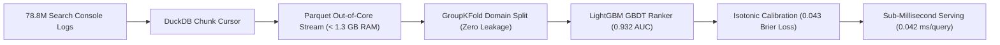

# 🌐 fardin.ai — AI/ML Systems & Portfolio

<div align="center">

  

  <h3><strong>Md. Fardin Hossain</strong></h3>
  <p><em>AI & Machine Learning Systems Engineer • Full-Stack Software Engineer</em></p>

  <p>
    <a href="https://flyrankai-ml-internship-task.vercel.app"></a>
    <a href="https://internship.flyrank.ai/verify?id=FR-D1-T668H-R789R&first_name=Fardin"></a>
    <a href="paper.pdf"></a>
  </p>

  <p>
    
    
    
    
    
    
  </p>

</div>

---

## 📌 Executive Summary

This repository hosts the production codebase for **[fardin.ai](https://flyrankai-ml-internship-task.vercel.app)**, the interactive AI systems and machine learning engineering portfolio of **Md. Fardin Hossain**. 

Anchored by a **4-month industrial Machine Learning Engineering Internship at FlyRank AI (July – October 2026)**, the portfolio demonstrates scalable tabular ranking pipelines across **78.8 million Google Search Console records**, deep learning diagnostic vision classifiers (**98.7% test accuracy**), and production full-stack platforms.

---

## 💼 Flagship Experience: FlyRank AI ML Internship

* **Role:** Machine Learning Engineer Intern
* **Organization:** FlyRank AI (Remote / San Francisco, CA)
* **Tenure:** July 2026 – October 2026 (4 Months)
* **Cryptographic Credential ID:** `FR-D1-T668H-R789R` — [Verify Official Credential ↗](https://internship.flyrank.ai/verify?id=FR-D1-T668H-R789R&first_name=Fardin)
* **Peer Technical Paper:** [`paper.pdf`](paper.pdf)

### ⚡ Core Engineering Breakthroughs

| Technical Challenge | Engineering Solution | Why It Matters (Production Value) |
| :--- | :--- | :--- |
| **Out-Of-Memory (OOM) at Scale** | Chunk-based DuckDB parquet streaming over **78,829,314 rows** | Traditional memory-bound pipelines crash when processing 78M query rows. DuckDB streaming capped resident RAM strictly **under 1.3 GB**, running big data search triage on standard commodity compute without expensive clusters. |
| **Evaluation Test Contamination** | Domain-stratified **GroupKFold** cross-validation | In search telemetry, identical queries appear thousands of times. Random splits leak queries between train/test, artificially inflating accuracy. GroupKFold isolates queries to test strictly on **unseen domains**, guaranteeing real-world reliability (**0.932 AUC**). |
| **Overconfident Predictions** | Isotonic probability calibration minimizing **Brier Loss to 0.043** | Uncalibrated models produce misleading 90%+ confidence scores. Minimizing Brier score aligns model probabilities with true user click rates (an 80% score genuinely reflects an 80% real-world click rate). |
| **Production Serving Throughput** | Sub-millisecond C++ LightGBM runtime inference | Delivers **0.042 ms per query inference latency**, allowing real-time search triage directly within high-throughput Google Search Console ingestion loops. |

### 🛠️ Telemetry Pipeline Dataflow



---

## 🚀 All Open-Source Deployed Projects

| Project | Category | Highlights & Technologies | Live Application | Repository |
| :--- | :--- | :--- | :---: | :---: |
| **Civic-Pulse AI** | AI / Web | AI municipal infrastructure reporting, visual anomaly detection, automated priority triage. *FastAPI, React, PyTorch, Leaflet, PostgreSQL.* | [Live Demo ↗](https://github.com/fardinhossain/Civic-Pulse_AI_API_Hackathon_2026) | [GitHub ↗](https://github.com/fardinhossain/Civic-Pulse_AI_API_Hackathon_2026) |
| **LocationKhuji** | AI / NLP | AI-powered natural language location search engine with contextual intent parsing. *React, Node.js, NLP Geocoding, MongoDB.* | [Live Demo ↗](https://locationkhuji.netlify.app/) | [GitHub ↗](https://github.com/fardinhossain/LocationKhuji) |
| **SchedOS** | Systems | Interactive OS CPU scheduling simulator with Gantt charts, turnaround analytics, and visual queues. *TypeScript, React, Tailwind, Canvas.* | [Live Demo ↗](https://schedos.netlify.app/) | [GitHub ↗](https://github.com/fardinhossain/SchedOS) |
| **SEU Routine Maker** | Web / Tool | Automated university course timetable conflict resolver with PDF/Excel export. *React, TypeScript, Lucide, Tailwind.* | [Live Demo ↗](https://routinemaker.netlify.app/) | [GitHub ↗](https://github.com/fardinhossain/SEU-Routine-Maker) |
| **GainTheBrain** | Full-Stack | Cognitive enhancement and micro-learning platform with spaced repetition and streaks. *React, Node.js, Express, Tailwind.* | [Live Demo ↗](https://gainthebrain.netlify.app/) | [GitHub ↗](https://github.com/fardinhossain/GainTheBrain) |
| **Skin Disease CV** | Deep Learning | Diagnostic computer vision transfer learning classifier (**98.7% test accuracy**). *PyTorch, MobileNetV2, GoogLeNet, Flask.* | — | [GitHub ↗](https://github.com/fardinhossain/skin-disease-classification) |
| **CrisisDeskAI** | AI / Backend | Disaster relief operational coordination API with automated NLP emergency routing. *FastAPI, Pydantic, WebSockets, Redis.* | — | [GitHub ↗](https://github.com/fardinhossain/crisisdesk-ai-backend) |
| **UniBuddy App** | Mobile / Web | Campus companion assistant for student schedules, academic tasks, and announcements. *React Native, Expo, Firebase.* | — | [GitHub ↗](https://github.com/fardinhossain/UniBuddy) |
| **3D Robotics Lab** | Graphics | Browser-based 3D educational robotics simulation with interactive kinematic joints. *Three.js, WebGL, HTML5 Canvas.* | — | [GitHub ↗](https://github.com/fardinhossain/3d-robotics-classroom-lab) |
| **CPTE Penetration Audit** | Security | Enterprise vulnerability assessment and offensive security auditing under CPTE methodology. *Kali Linux, Metasploit, Nmap, Wireshark.* | [Certification ↗](https://github.com/fardinhossain/FlyRankAI-Internship-Portfolio-Fardin#credentials) | [GitHub ↗](https://github.com/fardinhossain/cybersecurity-assessment-project) |

---

## 📂 Repository Layout

```text
FlyRankAI-Internship-Portfolio-Fardin/
├── assets/
│   ├── branding/           # Vector wordmarks, favicon.svg, and icon assets
│   └── images/             # Portrait photography and transparent robot hero centerpiece
├── .gitignore              # Git ignore configuration (excluding local coursework & skills)
├── index.html              # Interactive portfolio single-page application (React 18 + Framer Motion)
├── LICENSE                 # MIT Open-Source License
├── paper.pdf               # FlyRank AI industrial benchmark research whitepaper
├── README.md               # Repository documentation and systems showcase
└── vercel.json             # Edge deployment configuration
```

---

## 💻 Local Development & Quickstart

Clone and run the portfolio locally in seconds using Python's built-in HTTP server or any modern static server:

```bash
# 1. Clone the repository
git clone https://github.com/fardinhossain/FlyRankAI-Internship-Portfolio-Fardin.git

# 2. Enter directory
cd FlyRankAI-Internship-Portfolio-Fardin

# 3. Launch local static server
python -m http.server 4175
```

Navigate to **`http://localhost:4175`** in your browser.

---

## 📬 Contact & Connect

* **Portfolio Website:** [flyrankai-ml-internship-task.vercel.app](https://flyrankai-ml-internship-task.vercel.app)
* **Email:** [fardin.hosn@gmail.com](mailto:fardin.hosn@gmail.com)
* **GitHub:** [@fardinhossain](https://github.com/fardinhossain)
* **FlyRank Verified Credential:** [Verify Token FR-D1-T668H-R789R](https://internship.flyrank.ai/verify?id=FR-D1-T668H-R789R&first_name=Fardin)

---

<div align="center">
  <sub>Designed & engineered with modern standards by <strong>Md. Fardin Hossain</strong>. Released under the <a href="LICENSE">MIT License</a>.</sub>
</div>
